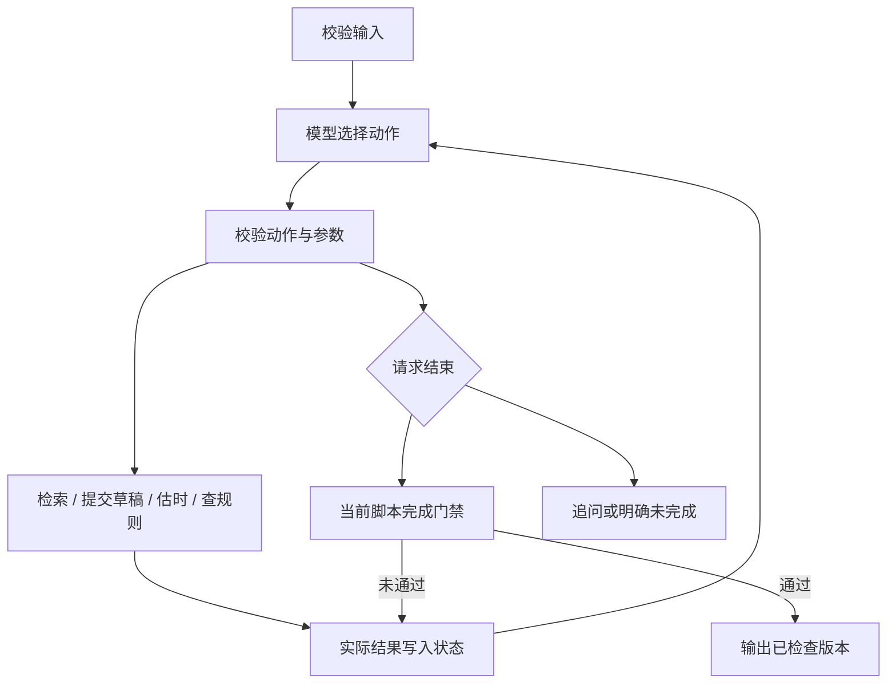

# 调用流程与技术取舍

2026-10-30 新增本地聊天层：`run_chat.py / chat_server.py` 启动仅本机可访问的服务；`chat.py` 负责逐轮需求整理、资料与会话持久化；`web/index.html` 提供对话及结果界面。真实对话整理使用一次独立的 LiveModel.complete 请求，然后复用下面的 Agent 循环。整理调用单独记入 dialogue.json，不混入 Agent 动作 Trace。离线整理为明确受限的字段解析器。

同产品、同主题改稿可传入上一版草稿，类型记为 conversation_previous_draft；先测量基线，再要求有变化的新稿，完成门禁不能接受未修改的旧稿。换主题或产品重启稿件。脚本修改后的两项检查仍必须重做。普通交流不生成本轮完成状态，显示旧稿时标明它是上次结果。会话重启恢复、并发拒绝、输入上限和缺密钥处理见聊天说明与测试。

实现使用 Python 标准库；没有外部 Agent 框架，也没有复制客服框架代码。参考了本地 `atguigu_ai` 的动作接口、状态管理、上限保护设计，重新实现较小的任务循环。

程序只控制合法动作、预算和完成门禁。真实模式每一步的查询、改稿或停止由模型根据状态与观察产生，不按用例 ID 选择动作。Mock 单独命名为固定规则模拟器，模式写入全部记录。

当前 allowed_actions 按状态过滤：同一版已有检查就不能再次请求相同检查；该产品全部资料已取得后不再重复检索；新稿清空检查后重新开放检查动作。输入初稿夹具时，先由模型选择时长测量再开放替换稿件，确保修正比较使用实际工具结果。这是执行骨架约束，删减内容及后续行动仍由模型决定。

H01/H02/H03 的同一批资料已参与调试，最终按开发回归报告，不再作为独立留出分数。源代码冻结后新增 fresh_materials.json 做一次新产品验证；它仍由同一助手编写，属于小样本补充而非外部盲测。

`schemas.py` 严格校验 JSON；`model_client.py` 通过兼容接口请求 JSON 动作；`agent.py` 管理状态与版本；`tools.py` 是三类业务工具；`cli.py` 保存证据；`scripts/evaluate.py` 与决策逻辑分离，按冻结场景验收。

模型接入参考了[阿里云兼容接口说明](https://help.aliyun.com/en/model-studio/qwen-api-via-openai-chat-completions)。实际验证使用 qwen-plus，非思考模式，temperature=0.1，无静默 SDK 重试。只保存结构化动作和审核结果，不要求或保存模型内部思维过程。API 网络请求有超时，总时间到达后即便模型迟到返回也不能完成。

真实运行发现模型会将 reason 放在 args 内。适配器只对这一明确的元数据层级错误做归位，不修改 action、工具参数或草稿；原始结构化返回保留在 model-calls.json，并写入 adapter_normalization。其他非法结构仍交给校验拒绝，不能把自动修复格式等同于模型业务决策。

时长采用旁白中文字数/4、英文词数/2.5，字幕中文字数/5、英文词数/3；每个标点加 0.15 秒，镜头取旁白、字幕、最小画面时长的最大值，镜间转场 0.25 秒。参数为演示假设，需真人配音校准。镜头与总时长保留两位小数。

检查绑定脚本、需求、资料、规则的内容哈希。修改脚本立即清空检查；重新发起检查前清除旧成功结果，避免后续检查失败仍沿用先前结果。最终脚本直接来自被检查对象，没有额外自由改写。

规则检查先做引用存在性和禁用词检查，再由独立请求上下文的模型审核标题与各镜头事实、否定和版本、额外必含内容。它使用同一模型，因此是辅助自动审核而非独立事实真值。Mock 只做保守的原文匹配，也不能验证创作质量。

首次验证中模型审核漏过了素材未说明的手机、按钮位置和“30秒上手”表述，因此增加了 R04 保守细节词表：具体术语若没有出现在该镜引用的原文中，直接阻断。这能拦截已知错误，但可能误伤合理的创作画面，不能替代通用语义验证。关键词只用于检索，产品事实以 text 正文为准；开发时删除了 P02 检索词中不受正文支持的“分割”。

检索采用中文双字片段与英文词重叠分数，可按产品精确过滤。这便于小数据复现，但不是语义检索；真实用户的同义问法可能需要模型重写。空结果和工具错误是不同 JSON 状态。

运行产物同时保存 source_hash 与资料版本。开发期间首次 smoke 运行有源码同时改动的情况，评测以冻结后的最终验收目录为准。需要外部强复现时，再记录最终 Git commit SHA；提交仓库为 https://github.com/djayp03-hub/short-video-script-agent ，最终以交付commit SHA定位版本。
